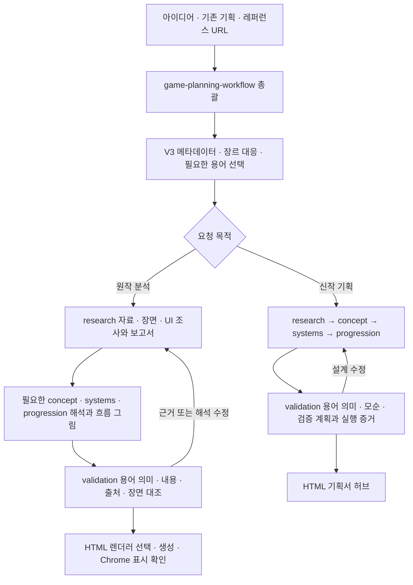

# 게임 분석과 신작 기획을 연결하는 스킬 워크플로우

원작 게임의 레퍼런스 보고서 또는 신작의 컨셉·규칙·진행 기획을 조사·작성·검수·로컬 HTML로 연결한다. **총괄 1개 + 단계 스킬 6개**, 현재 버전은 **v0.2.0**이다. V3 도메인 사전에서 장르에 맞는 용어를 선택해 집필하고 실제 문장의 의미를 검수한다. 원작 분석과 신작 설계의 산출물을 구분하고, 캡처가 없는 설명도 출처와 확인 범위를 밝혀 문서에 남긴다.

[게임 기획 스킬 사용 안내(HTML)](index.html)는 이 README의 내용을 웹페이지로 보여주는 `index.html`이다. V3 사전 조회, 원작 분석·신작 기획의 경로, 스킬 설치·사용 예시와 빌더의 한계를 안내한다. `start.command`를 실행한 뒤 [로컬 화면](http://127.0.0.1:4174/index.html)에서 확인할 수 있다.

## v0.2.0에서 달라진 점

- **장르별 용어 선택:** 사전 메타데이터로 실제 장르·하위 유형을 찾고 이름 정의와 전문어를 구별한다. 전체 사전 대신 필요한 범위만 읽는다.
- **보고서 작성과 검수 연결:** 정의·구별 기준·의미 차이·예문·ref를 확인해 프로젝트 명칭을 정하고, 실제 본문 사용 위치를 작성자와 검수 단계에 전달한다.
- **설치 후 바로 조회:** workflow 폴더에 V3 원문·조회 도구·공통 지침을 함께 포함한다. 이전 작업 폴더에 의존하지 않으며 Python 표준 라이브러리만 사용한다.

기존 7개 스킬 이름과 HTML 입력 형식 `version: 1`은 유지한다. [버전별 변경 이력](CHANGELOG.md)과 [검증 범위](VERIFICATION.md)를 함께 확인할 수 있다.

## 바로 보기

1. [워크플로우 화면 보기](http://127.0.0.1:4174/index.html) — 아래 로컬 서버를 실행한 컴퓨터에서 열린다.
2. [분석 내용과 사용법](README.md) — 이 저장소의 프로세스 분석과 스킬 호출 안내다.

```sh
git clone https://github.com/harness-subdev/harness-game-planning.git
cd harness-game-planning
python3 -m http.server 4174 --bind 127.0.0.1
```

Python 3가 필요하다. macOS에서는 `start.command`를 실행해도 된다. GitHub의 [index.html](index.html)은 소스 파일 보기이며, 실제 화면은 로컬 서버에서 확인한다.

## 스킬 설치

`skills/`의 7개 폴더를 `${CODEX_HOME:-~/.codex}/skills/` 아래 같은 이름으로 복사한다. 기존 동명 스킬이 있다면 내용을 비교한 뒤 갱신한다. 일곱 폴더의 상대 참조를 유지해야 한다.

필요한 흐름 그림에는 기존 `mermaid-diagrams`, 추가 브라우저 검수에는 `webapp-testing`을 사용한다. 두 보조 스킬은 이 저장소에 포함하지 않으며, 설치 루트의 같은 수준에 별도로 설치된 경우 상대 참조로 연결된다. 누락됐을 때의 처리와 Chrome 지원 API 사용 기준은 각 진입점에 명시되어 있다.

## V3 사전으로 장르별 용어 선택하기

보고서·기획을 시작할 때 [공통 조회 지침](skills/game-planning-workflow/references/domain-dictionary.md)에 따라 [V3 사전](skills/game-planning-workflow/references/game-domain-dictionary-v3.md)의 첫 HTML 주석에 있는 JSON 메타데이터를 확인한다. `schema=game-domain-dictionary-query/1`의 실제 노드에 대상의 조작·목표·진행을 대응시킨다. 기능이나 행동 이름을 새 하위 장르로 만들지 않는다.

다음 명령은 저장소 루트 기준이다. 설치 후에는 실제 설치된 `game-planning-workflow/scripts/query_dictionary.py` 경로로 실행한다. 도구는 사전을 내부에서 읽고 메타데이터 또는 선택한 표 행만 출력한다.

```sh
# 실제 노드·이름 키·참조 관계부터 확인
python3 skills/game-planning-workflow/scripts/query_dictionary.py --list
# FPS의 이름 정의와 전문어를 따로 조회
python3 skills/game-planning-workflow/scripts/query_dictionary.py 1.2.1 --mode genre_names
python3 skills/game-planning-workflow/scripts/query_dictionary.py 1.2.1 --mode terms
# FPS + 로그라이트의 필요한 범위를 각각 명시
python3 skills/game-planning-workflow/scripts/query_dictionary.py 1.2.1 1.23.2 --mode terms
# 공용 개념인 런은 별도 노드에서 해당 항목만 조회
python3 skills/game-planning-workflow/scripts/query_dictionary.py 2.6 --mode terms --scope direct --key '런(run)'
```

| 조회 선택 | 동작 |
| --- | --- |
| 기본 범위 | 선택 노드와 `parent` 역조회로 산출한 자손. 부모·`references`는 자동 회수하지 않음 |
| `--scope direct` | 선택 노드의 등록 앵커부터 본문 순서상 다음 등록 앵커 직전까지. 마지막 노드는 EOF까지 |
| `--mode all` | 선택 범위의 표 데이터 행 전체. CLI 기본값 |
| `--mode genre_names` | 각 노드의 `genre_name_keys`에 등록된 이름 정의 |
| `--mode terms` | 이름 정의를 제외한 전문어. 집필할 용어 선택에 사용 |
| `--key` | 선택 범위 안에서 정확한 key로 필터. 반복 가능하며 대소문자 포함 원문 표기 사용 |
| `--dictionary` | 사용자가 지정한 확정 사전 경로. 동일한 메타데이터 계약 필요 |

복합 장르는 각각 선택한다. 부모·공용·다른 장르의 개념이 필요하면 사용 목적과 별도 node/key를 명시해 조회한다. ARPG(`1.10.1`)·시간관리(`1.13.2`)처럼 직접 전문어가 없는 절은 빈 결과를 유지한다. 등록되지 않은 ID나 선택 범위에 없는 key는 오류로 구별한다.

선택한 행의 정의·구별 기준·의미 차이·예문·ref를 확인해 실제 대상·행동·결과에 맞는 명칭을 고른다. 예를 들어 반동과 탄퍼짐은 별개다. 사전 예문의 특정 반동 방향·크기나 런 초기화 조건을 실제 작품의 규칙 또는 신작 확정 설계로 가져오지 않는다. 작품 공식 명칭·사용자 결정·새 프로젝트 정의는 각각의 근거와 상태를 유지한다.

실제 사용하는 항목만 기존 프로젝트 사전 또는 `00-glossary.md`에 기록한다. 본문 명칭·쉬운 정의·구별·원어·명칭 상태·작품 규칙 근거와 사전 node ID/key·ref·본문 사용 위치를 연결한다. 사전 경로/해시·조회 범위·별도 참조·선택 이유는 기존 작업 기록에 남긴다. validation이 실제 문장과 개념 경계를 대조한 뒤 수정된 원문을 HTML에 투영한다. 내부 조회·검수 이력은 독자용 보고서와 HTML에 표시하지 않는다.

포함된 사전은 **129개 노드·653행(이름 정의 153개 + 전문어 500개)·120개 번호형 출처**의 확정 원문이다. 보고서 작업 중 사전을 재집필하지 않는다. 조회 지침과 프로젝트 명칭·문체 지침은 각각 [domain-dictionary.md](skills/game-planning-workflow/references/domain-dictionary.md), [game-terminology.md](skills/game-planning-workflow/references/game-terminology.md)가 맡는다.

## 실행 구조



총괄은 목적별 입력·출력과 다음 담당을 인계하고 작업 상태를 관리한다. 원작 보고서는 게임 개요 → 게임 메커니즘(아웃게임·인게임) → 핵심 설계 특징 → 참고자료와 조사 범위로 작성한다. 신작 기획의 의존 단계는 순서대로 작성한다. 자세한 중간 단계와 모드별 계약은 [총괄 스킬](skills/game-planning-workflow/SKILL.md)과 [산출물 계약](skills/game-planning-workflow/references/artifact-contract.md)이 정본이다.

원작의 자료·영상 탐색과 실제 관찰·캡처는 research가 맡는다. 연결 Chrome으로 원영상의 구간과 조건을 확인하고 저장 이미지까지 대조한다. 확보한 캡처는 시각·설명·직접 원영상 링크와 함께 배치한다. 캡처가 없으면 설명을 유지하되 `영상 관찰, 캡처 미첨부` / `자료 설명` / `장면 미확인`을 구분하며, 확인하지 못한 행동·시각을 관찰 사실로 쓰지 않는다. 필요한 경험·규칙·진행 해석만 담당 스킬로 분기한 뒤 validation과 HTML에 반환한다.

아래 표와 프로젝트 폴더 예시는 **신작 기획 경로**다.

| 단계 / 호출 스킬 | 하는 일 | 나오는 결과 |
| --- | --- | --- |
| 총괄 `$game-planning-workflow` | 범위·장르·용어 선택, 단계 인계, 검수, 재개·변경 영향 관리 | `workflow.json` |
| 1 `$game-planning-research` | 브리프·장르 대응, 필요한 용어·자료·장면 조사, 비교·충돌 확인 | `00-brief.md`, `sources.json`, `01-research.md` |
| 2 `$game-planning-concept` | 선택 용어로 핵심 경험·선택·반복 플레이·MVP 정의 | `02-concept.md` |
| 3 `$game-planning-systems` | 용어의 개념 경계를 유지하며 조작·상태·조건·효과·수치·예외 명세 | `03-systems.md` |
| 4 `$game-planning-progression` | 런·세션·성장을 구별하고 학습·난도·회복·콘텐츠 진행 설계 | `04-progression.md` |
| 5 `$game-planning-validation` | 실제 사용 문장의 용어 의미·모순·근거 대조, 검증 계획·실행 구분 | `05-validation.md` |
| 6 `$front-game-planning-html` | 검수된 원문의 명칭·정의·근거·상태를 보존해 HTML 생성 | `portal.json`, `index.html` |

개별 스킬도 호출할 수 있다. 각 단계는 입력, 수행 절차, 완료 기준, 다음 단계 인계가 명시되어 있다. 실제 입력이 부족하면 가정과 질문을 남기며, 단계마다 기계적으로 사용자 승인을 요구하지 않는다.

## 신작에서 자료를 설계로 연결하기

예를 들어 레퍼런스에서 짧은 세션을 관찰했다면, 곧바로 “우리 게임도 3분”으로 확정하지 않는다.

1. 실제로 확인한 세션 구조와 출처 위치를 기록한다.
2. 어떤 플레이어 선택 때문에 짧은 플레이가 성립하는지 해석한다.
3. 우리 게임의 제약에 맞는 적용 가설과 대안을 만든다.
4. 선택한 가설을 규칙과 콘텐츠 명세에 연결한다.
5. 프로토타입/관찰에서 무엇을 확인해야 하는지 기록한다.

출처 `S-01` → 관찰 `R-01` → 결정 `D-01` → 명세 `SYS-01` → 검증 `V-01`을 따라갈 수 있게 한다. 독창적인 아이디어는 새 가설로 표시하면 되며 외부 근거를 꾸밀 필요가 없다.

## 프로젝트별 결과 폴더

```text
your-project/game-planning/
├── 00-brief.md
├── 00-glossary.md      # 실제 사용 명칭·정의·근거·본문 위치
├── sources.json
├── 01-research.md
├── 02-concept.md
├── 03-systems.md
├── 04-progression.md
├── 05-validation.md
├── workflow.json
├── portal.json         # 문서에서 생성한 열람용 데이터
└── index.html          # 빌드 결과, 파일을 직접 열어도 동작
```

증거 파일은 실제로 생성한 경우에만 `evidence/`에 둔다. 설명용 애니메이션, 실제 플레이 프로토타입, 수치 계산기는 해당 기획의 질문을 해결할 때만 추가한다. 모든 게임에 동일한 시뮬레이터나 스테이지 표를 강제하지 않는다.

정본 Markdown 수정 → 표시용 portal.json 재생성 → HTML 빌드 순서로 갱신한다. 빌더는 JSON을 HTML로 변환한다. Markdown의 의미를 자동 분석하거나 파일 변경을 백그라운드에서 감시하는 프로그램은 아니다.

제공 빌더의 `portal.json` 형식 버전은 정수 `1`이다. 텍스트·표·한 단계 상세·상태를 지원하며 이미지·Mermaid·더 깊은 중첩을 지원하지 않는다. 원작 보고서는 [HTML 스킬의 렌더러 선택](skills/front-game-planning-html/SKILL.md#렌더러-선택)에 따라 필요한 표시를 지원하는 기존 렌더러 또는 요청 범위의 최소 보완을 사용한다. 이 게시 작업에서는 런타임을 변경하지 않았다.

## 사용 예시

원작 레퍼런스 보고서:

```text
$game-planning-workflow
제공한 게임의 규칙과 진행을 조사해 원작 레퍼런스 보고서와 로컬 HTML로 만들어줘.
전체 구조 소개와 상세 분석 대상을 구분하고, 실제 자료·영상·UI의 확인 범위를 밝혀줘.
V3 사전에서 해당 장르의 이름 정의와 필요한 전문어를 확인해 쓰고,
실제 본문의 용어 의미와 작품 규칙 근거를 검수해줘.
```

신작 기획:

```text
$game-planning-workflow
새 모바일 퍼즐을 기획해줘.
대상은 짧게 플레이하는 성인, 세로 화면과 한 손 조작이 필요해.
개발팀은 2명이고 먼저 작은 MVP를 만들 계획이야.
제공한 자료와 관련 레퍼런스를 조사한 뒤,
핵심 재미·규칙·콘텐츠·진행·검증 계획을 작성하고
로컬에서 읽을 수 있는 HTML 기획서까지 만들어줘.
```

복합 장르의 용어부터 확인할 때:

```text
$game-planning-workflow
FPS와 로그라이트를 결합한 신작 기획을 작성해줘.
V3 메타데이터로 각 장르 범위를 명시하고 반동과 탄퍼짐을 구별해줘.
런은 필요한 공용 정의를 별도 조회하고, 종료·유지 조건은 신작 설계로 구분해줘.
확정되지 않은 규칙은 제안 또는 미정으로 남겨줘.
```

기존 기획을 이어갈 때:

```text
$game-planning-workflow
이 프로젝트의 game-planning/workflow.json부터 확인해줘.
실패하면 처음부터 재시작하는 규칙을 체크포인트 방식으로 바꾸고,
영향받는 시스템·진행·검증과 HTML을 갱신해줘.
```

단계만 실행할 때:

```text
$game-planning-research 첨부한 게임 아이디어에 맞는 레퍼런스를 조사해줘.
$game-planning-validation 현재 기획의 모순과 미검증 가설을 점검해줘.
$front-game-planning-html 현재 기획 문서를 로컬 HTML로 생성해줘.
```

설치한 스킬이 현재 대화의 시작 목록에 아직 보이지 않으면 새 작업을 열거나 해당 SKILL.md 경로를 지정해 읽게 하면 된다. 이 묶음의 설치 경로와 검수 결과는 [검증 기록](VERIFICATION.md)에 남긴다.

## 재개와 완료의 의미

완료 단계의 입력 해시와 출력 존재를 확인한다. 규칙이 바뀌면 영향받는 진행·검증·HTML을 다시 검토하고, 오탈자 수정이면 원문과 HTML만 갱신한다. 미확인 값을 0으로 채우지 않는다. 기획의 확정 상태, 구현 상태, 검증 근거도 따로 표시한다.

원작 보고서 완료는 요청한 설명·근거와 열람본의 확인 범위로 판단한다. 신작 기획 완료는 요청한 설계·검증 계획의 작성 상태로 판단하며, 실제 플레이 결과가 없으면 재미는 미검증이다. 고정 횟수의 반복 인터뷰·검수 관문을 강제하지 않는다.

## 버전과 빌드

[VERSION](VERSION)이 유일한 의미 버전 정본이며 현재 값은 `0.2.0`이다. [CHANGELOG](CHANGELOG.md)에 해당 버전의 실제 변경 내용과 한계를 기록한다. README와 예시 HTML의 버전 표시는 이 값을 반영한다. `portal.json`의 `version: 1`은 입력 형식 버전으로 별개다.

다음 버전은 `VERSION`을 수동으로 갱신하고 같은 버전의 변경 내역을 추가한 뒤 README·포털 표시를 갱신한다. [검증 기록](VERIFICATION.md)의 기존 Python 자체 점검·빌드 명령을 실행하고 함께 커밋한다. 빌드 대상은 정확한 Git 커밋 SHA로 식별하며, 커밋 시각이나 실행 횟수를 의미 버전 대신 사용하지 않는다. GitHub Actions·자동 버전 증가·태그·릴리스 발행은 구성하지 않았다.

## 제공된 Avoid Ball 분석 기록

아래는 이전에 제공된 자료·미러의 분석 기록이다. 원저자의 실제 검색·작성 순서를 복원한 결과가 아니며, v0.1.0 게시 작업에서 원사이트나 게임을 새로 관찰하지 않았다.

| 분석 | 근거 | 재사용 방식 |
| --- | --- | --- |
| 컨셉 → 상세 항목 → 행동 예시 → 진행 지도라는 열람 동선 | [홈](https://avoid-ball.netlify.app/), [컨셉](https://avoid-ball.netlify.app/planning/concept.html) | 다른 게임도 큰 흐름을 먼저 읽고 상세로 들어가게 구성 |
| 적 기획 데이터 한 벌을 상세 문서와 예시가 공유 | [enemy-plans.js](https://avoid-ball.netlify.app/planning/enemy-plans.js), [선택 처리](https://avoid-ball.netlify.app/planning/enemy-select.js) | 안정적인 ID와 정본을 정하고 여러 화면은 파생 |
| 기획 의도, 실제 배치, 계산 결과, HTML 표시를 분리한다는 설계 | [원본 README](https://avoid-ball.netlify.app/planning/README.md) 24–44행 | 목표·명세·계산·실측을 구분하고 생성 결과 직접 수정을 피함 |
| 설명용 SVG는 실제 충돌·풀이 검증이 아님 | [원본 README](https://avoid-ball.netlify.app/planning/README.md) 15행 | 필요한 게임에만 도식을 만들고 표현 범위 표시 |
| 계산 지표와 실제 재미·성공률을 구분 | [원본 README](https://avoid-ball.netlify.app/planning/README.md) 80–86행 | 문서 준비 완료와 게임 검증 완료를 별도 상태로 관리 |
| 자료의 설명과 현재 데이터 버전이 일부 다름 | [README](https://avoid-ball.netlify.app/planning/README.md) 80행, [campaign.json](https://avoid-ball.netlify.app/planning/data/campaign.json) | 조사 초기에 버전·범위·상충 정보 확인 |
| 검색 이력과 설계 결정 추적은 원본에 충분히 남아 있지 않음 | 현재 보존된 문서·코드 범위 | 새로 조사 질문 → 관찰 → 해석 → 결정 → 명세 → 검증 연결 추가 |

당시 분석 기록에는 원본 README가 구조 점수를 v2/10개 항목으로 설명하지만 데이터에는 v3 294단계와 v4 6단계가 섞여 있고, v4는 12개 항목/120점이라고 남아 있다. 이 때문에 자료 설명과 정본의 일치 여부를 구분한다. 당시 로컬 미러에는 상류 CSV·Stage JSON·생성기가 없어 그 원본 빌드 실행 여부는 검증하지 못했다.

적 16종, 300단계, 10단계 단위 도입, 50단계마다 높은 난도, 격자 기반 점수식은 분석 대상에 관한 값이다. 당시 분석 대상 포털의 코드·CSS에 고정된 값을 다른 게임의 기본값으로 가져가지 않는다. 신작의 진행 단위와 규칙은 해당 게임에서 결정한다.
