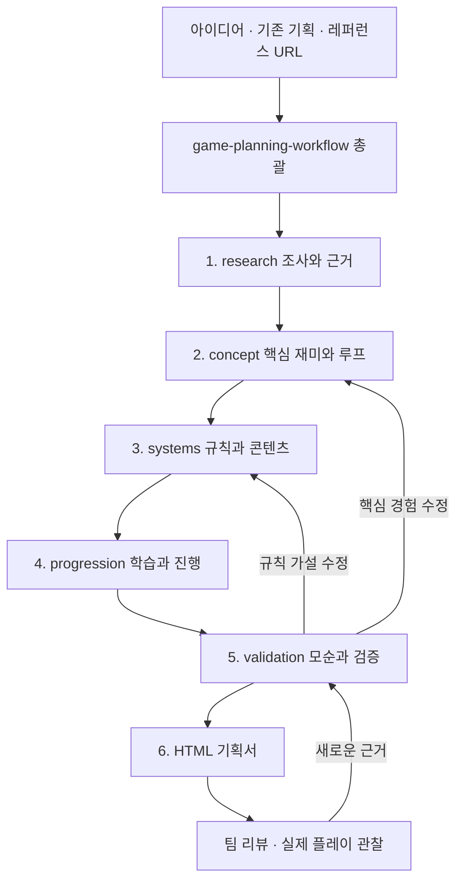

# 게임 기획을 만드는 단계별 스킬 워크플로우

다른 게임의 기획 자료를 조사하고, 그 근거를 게임의 컨셉·규칙·진행 설계로 연결해 실제 기획서와 로컬 HTML로 완성하는 구조다. **총괄 1개 + 단계 스킬 6개**로 구성했다. 제공된 Avoid Ball 기획서의 정보 구조를 분석했으며, 원저자가 실제 사용한 검색·작성 순서를 복원했다고 주장하지 않는다.

[워크플로우 HTML](index.html)을 열거나 `start.command`를 실행한 뒤 [로컬 화면](http://127.0.0.1:4174/index.html)에서 확인할 수 있다.

## 바로 보기

1. [워크플로우 화면 보기](http://127.0.0.1:4174/index.html) — 아래 로컬 서버를 실행한 컴퓨터에서 열린다.
2. [분석 내용과 사용법](README.md) — 이 저장소의 프로세스 분석과 스킬 호출 안내다.

원래 작업 공간의 [분석 내용과 사용법](/Users/igyeongseob/Develop/08_side/storio_games/기획분석/game-planning-workflow/README.md) 링크는 해당 로컬 환경에서만 사용할 수 있다. 다른 컴퓨터에서는 위 저장소 내부 링크를 사용한다.

```sh
git clone https://github.com/harness-subdev/harness-game-planning.git
cd harness-game-planning
python3 -m http.server 4174 --bind 127.0.0.1
```

Python 3가 필요하다. macOS에서는 `start.command`를 실행해도 된다. GitHub의 [index.html](index.html)은 소스 파일 보기이며, 실제 화면은 로컬 서버에서 확인한다.

## 스킬 설치

`skills/`의 7개 폴더를 `${CODEX_HOME:-~/.codex}/skills/` 아래 같은 이름으로 복사한다. 기존 동명 스킬이 있다면 내용을 비교한 뒤 갱신한다. 일곱 폴더의 상대 참조를 유지해야 한다.

## 실행 구조



총괄은 입력과 출력을 인계하고, 단계 상태와 결정 이력을 관리한다. 자료 조사와 독립 검수는 병렬화할 수 있다. 컨셉에 의존하는 시스템, 시스템에 의존하는 진행 설계는 순서대로 작성한다. 실행은 Codex 대화 안에서 수행하며 별도 서버나 예약 실행은 필요 없다.

| 단계 / 호출 스킬 | 하는 일 | 나오는 결과 |
| --- | --- | --- |
| 총괄 `$game-planning-workflow` | 범위 확인, 단계 선택, 인계, 검수, 재개·변경 영향 관리 | `workflow.json` |
| 1 `$game-planning-research` | 브리프 정리, 조사 질문, 공개 자료·기존 문서 검토, 비교, 충돌 확인 | `00-brief.md`, `sources.json`, `01-research.md` |
| 2 `$game-planning-concept` | 조사에서 설계 기회 도출, 핵심 재미·선택·반복 플레이·MVP 정의 | `02-concept.md` |
| 3 `$game-planning-systems` | 조작, 상태, 발동 조건, 효과, 피드백, 예외, 수치·콘텐츠 명세 | `03-systems.md` |
| 4 `$game-planning-progression` | 처음 배우는 것부터 응용·숙련까지, 세션/스테이지/성장 흐름 설계 | `04-progression.md` |
| 5 `$game-planning-validation` | 모순·누락 확인, 가설별 테스트 설계, 실제 결과와 미실행 구분 | `05-validation.md` |
| 6 `$front-game-planning-html` | 원문에서 열람 데이터를 만들고 목차·상세·근거가 있는 HTML 생성 | `portal.json`, `index.html` |

개별 스킬도 호출할 수 있다. 각 단계는 입력, 수행 절차, 완료 기준, 다음 단계 인계가 명시되어 있다. 실제 입력이 부족하면 가정과 질문을 남기며, 단계마다 기계적으로 사용자 승인을 요구하지 않는다.

## 원본에서 확인한 것과 추가한 것

| 분석 | 근거 | 재사용 방식 |
| --- | --- | --- |
| 컨셉 → 상세 항목 → 행동 예시 → 진행 지도라는 열람 동선 | [홈](https://avoid-ball.netlify.app/), [컨셉](https://avoid-ball.netlify.app/planning/concept.html) | 다른 게임도 큰 흐름을 먼저 읽고 상세로 들어가게 구성 |
| 적 기획 데이터 한 벌을 상세 문서와 예시가 공유 | [enemy-plans.js](https://avoid-ball.netlify.app/planning/enemy-plans.js), [선택 처리](https://avoid-ball.netlify.app/planning/enemy-select.js) | 안정적인 ID와 정본을 정하고 여러 화면은 파생 |
| 기획 의도, 실제 배치, 계산 결과, HTML 표시를 분리한다는 설계 | [원본 README](https://avoid-ball.netlify.app/planning/README.md) 24–44행 | 목표·명세·계산·실측을 구분하고 생성 결과 직접 수정을 피함 |
| 설명용 SVG는 실제 충돌·풀이 검증이 아님 | [원본 README](https://avoid-ball.netlify.app/planning/README.md) 15행 | 필요한 게임에만 도식을 만들고 표현 범위 표시 |
| 계산 지표와 실제 재미·성공률을 구분 | [원본 README](https://avoid-ball.netlify.app/planning/README.md) 80–86행 | 문서 준비 완료와 게임 검증 완료를 별도 상태로 관리 |
| 자료의 설명과 현재 데이터 버전이 일부 다름 | [README](https://avoid-ball.netlify.app/planning/README.md) 80행, [campaign.json](https://avoid-ball.netlify.app/planning/data/campaign.json) | 조사 초기에 버전·범위·상충 정보 확인 |
| 검색 이력과 설계 결정 추적은 원본에 충분히 남아 있지 않음 | 현재 보존된 문서·코드 범위 | 새로 조사 질문 → 관찰 → 해석 → 결정 → 명세 → 검증 연결 추가 |

원본 README는 구조 점수를 v2/10개 항목으로 설명하지만 현재 데이터에는 v3 294단계와 v4 6단계가 섞여 있고, v4는 12개 항목/120점이다. 이 때문에 “자료에 쓰여 있다”와 “현재 정본과 일치한다”를 구분한다. 상류 CSV·Stage JSON·생성기는 현재 로컬 미러에 없으므로 그 원본 빌드의 실행 여부까지 검증한 것은 아니다.

다른 게임에 적 16종, 300단계, 10단계 단위 도입, 50단계마다 높은 난도, 격자 기반 점수식 등을 가져가지 않는다. 현재 포털에는 이 값이 코드와 CSS에 고정되어 있으므로 단순 JSON 교체로 범용화하지 않았다. 학습과 응용의 목적을 가져오고, 진행 단위와 규칙은 새 게임에서 결정한다.

## 핵심은 자료를 설계로 연결하는 것

예를 들어 레퍼런스에서 짧은 세션을 관찰했다면, 곧바로 “우리 게임도 3분”으로 확정하지 않는다.

1. 실제로 확인한 세션 구조와 출처 위치를 기록한다.
2. 어떤 플레이어 선택 때문에 짧은 플레이가 성립하는지 해석한다.
3. 우리 게임의 제약에 맞는 적용 가설과 대안을 만든다.
4. 선택한 가설을 규칙과 콘텐츠 명세에 연결한다.
5. 프로토타입/관찰에서 무엇을 확인해야 하는지 기록한다.

출처 `S-01` → 관찰 `R-01` → 결정 `D-01` → 명세 `SYS-01` → 검증 `V-01`을 따라갈 수 있게 한다. 독창적인 아이디어는 새 가설로 표시하면 되며 외부 근거를 꾸밀 필요가 없다.

## 프로젝트별 결과 폴더

```text
your-project/game-planning/
├── 00-brief.md
├── sources.json
├── 01-research.md
├── 02-concept.md
├── 03-systems.md
├── 04-progression.md
├── 05-validation.md
├── workflow.json
├── portal.json         # 문서에서 생성한 열람용 데이터
└── index.html          # 빌드 결과, 파일을 직접 열어도 동작
```

증거 파일은 실제로 생성한 경우에만 `evidence/`에 둔다. 설명용 애니메이션, 실제 플레이 프로토타입, 수치 계산기는 해당 기획의 질문을 해결할 때만 추가한다. 모든 게임에 동일한 시뮬레이터나 스테이지 표를 강제하지 않는다.

정본 Markdown 수정 → 표시용 portal.json 재생성 → HTML 빌드 순서로 갱신한다. 빌더는 JSON을 HTML로 변환한다. Markdown의 의미를 자동 분석하거나 파일 변경을 백그라운드에서 감시하는 프로그램은 아니다.

## 사용 예시

개인 스킬 설치 후 다른 프로젝트에서 다음처럼 요청한다.

```text
$game-planning-workflow
새 모바일 퍼즐을 기획해줘.
대상은 짧게 플레이하는 성인, 세로 화면과 한 손 조작이 필요해.
개발팀은 2명이고 먼저 작은 MVP를 만들 계획이야.
제공한 자료와 관련 레퍼런스를 조사한 뒤,
핵심 재미·규칙·콘텐츠·진행·검증 계획을 작성하고
로컬에서 읽을 수 있는 HTML 기획서까지 만들어줘.
```

기존 기획을 이어갈 때:

```text
$game-planning-workflow
이 프로젝트의 game-planning/workflow.json부터 확인해줘.
실패하면 처음부터 재시작하는 규칙을 체크포인트 방식으로 바꾸고,
영향받는 시스템·진행·검증과 HTML을 갱신해줘.
```

단계만 실행할 때:

```text
$game-planning-research 첨부한 게임 아이디어에 맞는 레퍼런스를 조사해줘.
$game-planning-validation 현재 기획의 모순과 미검증 가설을 점검해줘.
$front-game-planning-html 현재 기획 문서를 로컬 HTML로 생성해줘.
```

설치한 스킬이 현재 대화의 시작 목록에 아직 보이지 않으면 새 작업을 열거나 해당 SKILL.md 경로를 지정해 읽게 하면 된다. 이 묶음의 설치 경로와 검수 결과는 [검증 기록](VERIFICATION.md)에 남긴다.

## 재개와 완료의 의미

완료 단계의 입력 해시와 출력 존재를 확인한다. 규칙이 바뀌면 영향받는 진행·검증·HTML을 다시 검토하고, 오탈자 수정이면 원문과 HTML만 갱신한다. 미확인 값을 0으로 채우지 않는다. 기획의 확정 상태, 구현 상태, 검증 근거도 따로 표시한다.

문서가 완성되어도 실제 플레이 결과가 없으면 게임 재미는 미검증이다. 이 워크플로우의 완료 결과는 “근거와 검증 계획이 있는 기획서”이며, 실제 관찰이 들어오면 그 결과로 설계를 반복한다.
